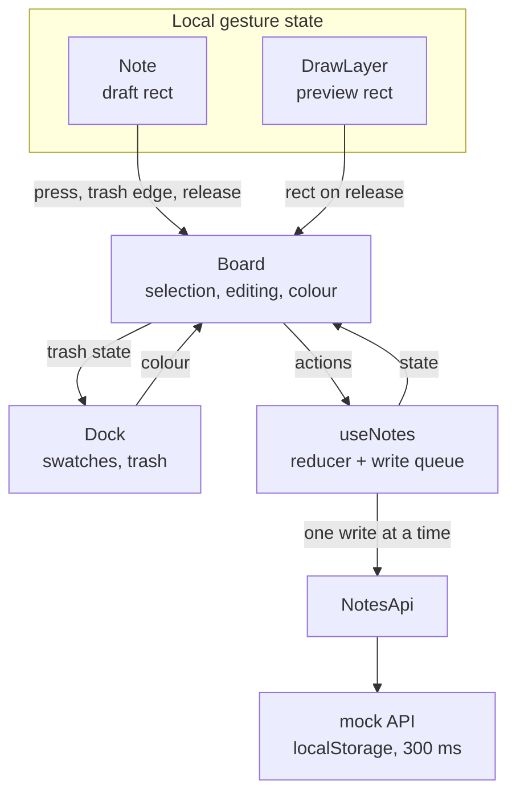

# Sticky Notes

A sticky-notes board in React and strict TypeScript, with the four core features and all five bonus features: text, bring to front, `localStorage`, colours and an asynchronous mock REST API. The only runtime dependencies are `react` and `react-dom`.

[`demo.mp4`](demo.mp4) is a one-minute screen recording that walks through every feature (no sound).

## Running it

Requires Node 24 or later.

```sh
npm install
npm run dev        # http://localhost:5173
npm run build      # type-check, then build into dist/
npm test           # Vitest unit and component tests
npm run coverage   # the same tests with a coverage report (100% of src/ covered)
npm run lint       # Biome: lint and format check
npm run typecheck  # tsc --noEmit
```

## Using it

- **Create:** press on empty board and drag; the rectangle becomes the note, with a live size readout. Anything under 80×60 is discarded, so a stray click creates nothing. Double-clicking empty board creates a 200×160 note. New notes open for typing. Until there is a note, a line in the middle of the board says how.
- **Move** a note by dragging it; **resize** it from its bottom-right grip. A press that travels less than 4 px is a click, so a shaky click or double-click never nudges a note. Notes stop at the top and left edges; to the right and down, the board grows and scrolls.
- **Delete** a note by dropping it on **Trash** in the dock. The trash outline darkens while a note moves; with the pointer over it, the trash tints and the note fades.
- **Press** a note to bring it to the front and select it. Press empty board to deselect.
- **Edit** text with a double-click. Escape or clicking elsewhere finishes and saves. While editing, dragging in the text selects it, and dragging the note by its edge moves it and finishes the edit.
- **Colour:** a swatch sets the colour for new notes and recolours the selected note.
- **Escape** during a draw, move or resize cancels it.

The top-right corner shows "Saving…" or "Saved".

## Assumptions

- "A new note of the specified size at the specified position" means the user specifies both by drawing the note, not by typing numbers.
- "Desktop" means a mouse or trackpad. Touch input is not handled.
- "React vanilla (without stock components)" rules out component and drag-and-drop libraries at runtime, not development tooling (Vite, Vitest, Biome).
- API calls always succeed. The mock never fails, so there are no error messages, retries or rollback of a change that could not be saved.
- One person uses the board in one tab. A second tab loads the saved notes when it opens and does not follow changes made in the first.
- The brief does not mention AI tools. I assumed that in 2026 their use is a given and worked the way I would on any real project. The code is built to my standards, and I take ownership of every line and every decision in it.

## Architecture

Each component has a folder under `src/components` holding the markup (`Note.tsx`), its logic as a hook when it has any (`useNote.ts`) and its helpers. `src/hooks` keeps only the hooks that no single component owns: `usePointerDrag` and `useNotes`.

Under the components are three layers of plain TypeScript, each depending only on the ones before it. `src/model` holds the types, the pure gesture geometry (`applyGesture` maps a move, resize or draw plus a pointer position to a rectangle) and `notesReducer`, which owns the committed notes. `src/api` defines `NotesApi`, a REST-shaped interface, and a mock that waits 300 ms per call and keeps the list in `localStorage`. `src/persistence` maps each reducer action to its API call (`persistAction`) and runs those calls one at a time (`createWriteQueue`). The `useNotes` hook joins this to React: it applies an action, renders the result and queues the write. `main.tsx` creates the API and passes it to `Board`, so tests pass in a fake.

Performance rests on one rule: a pointer move re-renders only the component being dragged, and committed state changes once, on release. `usePointerDrag` captures the pointer, ignores it until it has travelled 4 px (so a click moves nothing), then coalesces `pointermove` to one update per animation frame, re-applies the last position when the board scrolls, and cancels on Escape, `pointercancel` or unmount. It knows nothing about notes. `Note` keeps the in-flight rectangle in local state until release, and `DrawLayer` does the same for its preview. Notes are memoized, positioned with `transform` and given only stable callbacks, so a commit re-renders just the notes whose props changed. During a move, `Board` hears from the note only at the start, when the pointer crosses the trash edge, and at the end.

`Board` owns the state that is not saved: the selection, the note being edited, the colour for new notes and the trash highlight. Positions are board pixels from the top-left of the scrollable surface, independent of scroll position and window size. `useBoardGeometry` converts pointer positions into them in one place, and measures the trash in viewport coordinates because the dock is fixed to the window. The surface grows to the furthest note plus a margin.



## UI options considered

- **A. Toolbar form:** width, height, x and y fields, an Add button and a corner trash. The most literal reading of the brief and the quickest to build, but nobody wants to place a note by typing pixels, and a corner trash means long drags.
- **B. Palette rail:** drag a coloured pad off a side rail to create a default-size note, then resize it. Easy to discover, but size and position take two gestures, and the rail eats width at 1024 px.
- **C. Draw on the board, with a dock (chosen).** I chose it because the rectangle you draw is the note: size and position in one gesture, and creating, moving and resizing are all direct manipulation. The dock holds the colours and a trash that is always visible and never moves or grows. The cost is that drawing is not obvious: an empty board says how in one line, the crosshair cursor hints at it, and a double-click also creates a note.

## Decisions and trade-offs

- **A `z` number per note instead of array order.** Raising sets `z` to one above the highest, and DOM order never changes, because moving a DOM node mid-press can drop pointer capture or textarea focus. The board is its own stacking context, so no `z` can rise above the dock.
- **Optimistic, serial writes.** The screen updates at once and the API calls run one at a time, in order, so two updates to a note cannot land out of order whatever the latency. Computed values, such as a raised note's `z`, are read from the new state, so storage matches the screen. A reload while "Saving…" is showing loses the writes still queued, as it would with a real API.
- **One mock for two bonus features.** An asynchronous API stored in `localStorage` covers both "save to local storage" and "save to a REST API"; a `fetch`-based `NotesApi` would replace it in `main.tsx` without touching a component. Stored JSON is parsed as `unknown` and filtered through the `isNote` type guard.
- **Native scrolling, no pan or zoom.** Scrollbars, wheel and trackpad work as usual, and resizing the window never moves a note. There is no auto-scroll at the window edge: drop the note, scroll, drag again.
- **Text is saved when editing ends** (blur, Escape, or a press elsewhere that closes the editor): one write per edit, not per keystroke.
- **Delete by pointer position,** not note overlap, so a large note is not deleted by accident. Resizing never deletes.
- **Strict typing.** `strict`, `noUncheckedIndexedAccess` and `exactOptionalPropertyTypes` are on, and Biome forbids `any`, non-null assertions and type assertions. Besides `as const`, the one assertion brands a string as a `NoteId` in `toNoteId`, where there is nothing to check at runtime. Actions and gestures are discriminated unions with exhaustive `switch`es.

## Tests

The brief does not ask for tests. I wrote them because most of the logic is plain functions that are cheap to test, and because they let me change the drag code without re-checking every gesture by hand. They live in `tests/`, which mirrors `src/`, so `src/` holds only the application. Run them with `npm test`.

## Left out on purpose

- Touch, mobile, and screens below 1024×768.
- Keyboard-only moving and resizing (notes are not keyboard-focusable), undo, multi-select and rich text.
- Pan, zoom and auto-scroll at the window edge.
- A real backend.
- End-to-end tests in the repository. The model, mock API, persistence layer and hooks have unit tests, and `Note` and `Board` have component tests in jsdom. I checked real browsers separately (below).

## Browsers

I developed and checked it in current Chrome and Firefox on macOS: moving, resizing, trashing, text editing, colours, stacking, reloading, and dragging with 500 notes on the board. I have not tested Edge, Windows or Linux: Edge shares Chrome's engine, and the app uses only standard, long-supported web APIs (Pointer Events, `requestAnimationFrame`, `localStorage`, CSS transforms) with no browser- or platform-specific code.
